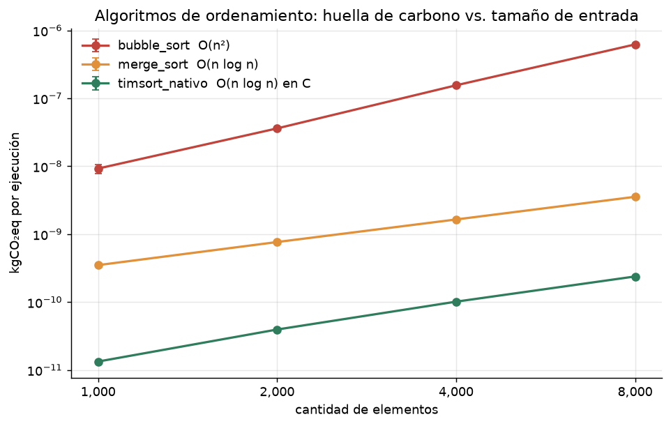
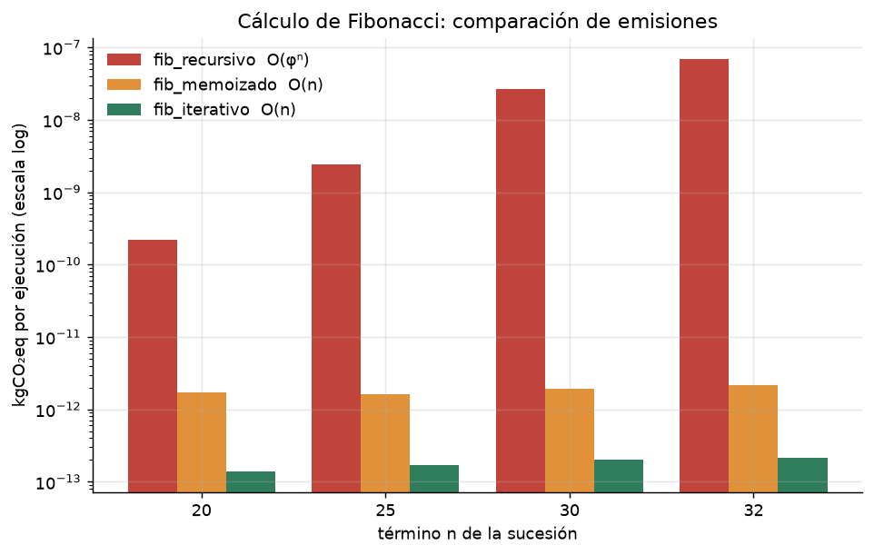
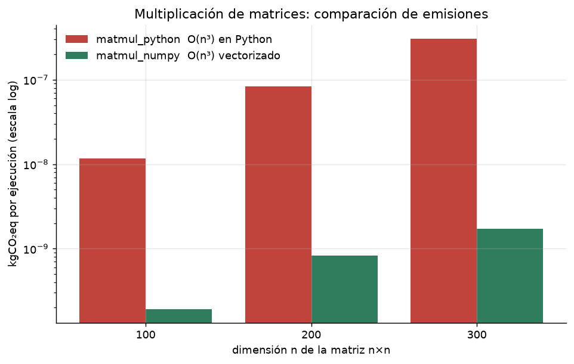
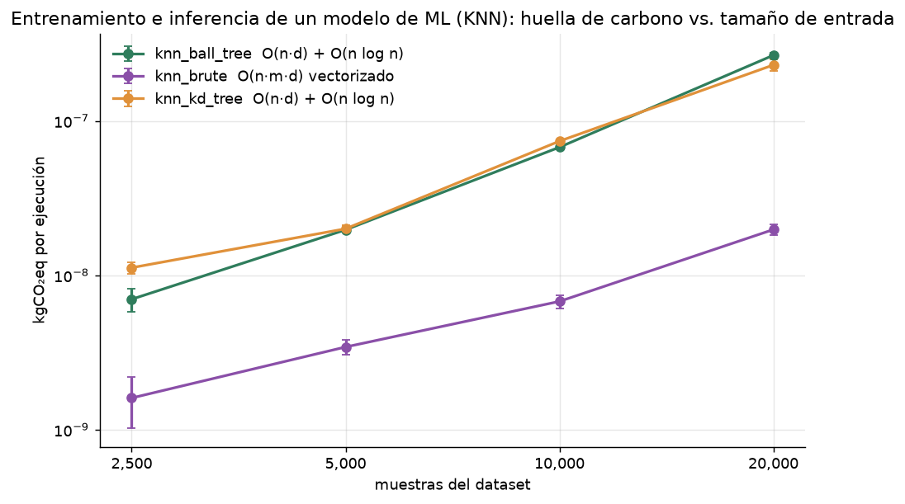
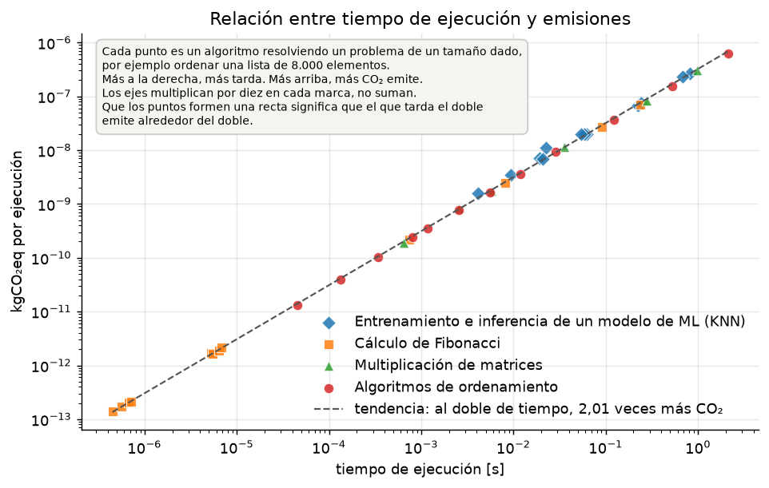

# Medición de la huella de carbono de algoritmos en Python

**Green Software — Universidad Tecnológica Nacional - FRC**

Fecha de la corrida: 2026-09-01 19:35:49

> Todas las cifras de este informe salen de las mediciones registradas en la corrida
> indicada arriba. Ninguna fue escrita a mano ni tomada de otra fuente.

---

## 1. Objetivo e hipótesis

**Objetivo.** Medir la huella de carbono asociada a la ejecución de algoritmos en
Python y determinar si las decisiones de diseño algorítmico tienen una consecuencia
ambiental cuantificable.

**Hipótesis.** Dos implementaciones que producen exactamente el mismo resultado
pueden diferir en órdenes de magnitud en energía consumida y, por lo tanto, en CO₂
emitido. La complejidad computacional no es solo una propiedad teórica: se traduce
en consumo eléctrico y en emisiones.

**Diseño experimental.** Cuatro experimentos, cada uno con variantes que resuelven el
mismo problema y devuelven el mismo resultado (equivalencia verificada por
aserción antes de cada medición):

- **Algoritmos de ordenamiento** — `bubble_sort` (O(n²)), `merge_sort` (O(n log n)), `timsort_nativo` (O(n log n) en C)
- **Cálculo de Fibonacci** — `fib_recursivo` (O(φⁿ)), `fib_memoizado` (O(n)), `fib_iterativo` (O(n))
- **Multiplicación de matrices** — `matmul_python` (O(n³) en Python), `matmul_numpy` (O(n³) vectorizado)
- **Entrenamiento e inferencia de un modelo de ML (KNN)** — `knn_brute` (O(n·m·d) vectorizado), `knn_kd_tree` (O(n·d) + O(n log n)), `knn_ball_tree` (O(n·d) + O(n log n))

## 2. Marco teórico

La huella de carbono de un cómputo se obtiene multiplicando la energía eléctrica
consumida por la intensidad de carbono de la red que la suministra:

```
CO₂ [kgCO₂eq]  =  E [kWh]  ×  FE [kgCO₂eq/kWh]  ×  PUE
```

donde FE es el factor de emisión de la red eléctrica y PUE (*Power Usage
Effectiveness*) contabiliza la infraestructura de soporte, como la refrigeración de
un datacenter.

### Factor de emisión de la red argentina

Se adopta **FE = 346,0 gCO₂eq/kWh = 0,346 kgCO₂eq/kWh**, correspondiente a 2025, el año más reciente disponible para Argentina.

Fuente: Ember (2026), Yearly Electricity Data — con procesamiento de Our World in Data
(<https://ourworldindata.org/grapher/carbon-intensity-electricity>, descargado el 2026-08-22). El indicador es la
*intensidad de carbono de ciclo de vida de la generación eléctrica*. La serie completa está
versionada en `datos/intensidad_carbono_argentina.json` y el proyecto
selecciona el último año disponible en cada corrida, de modo que el valor no puede
quedar desactualizado ni escrito a mano.

Evolución reciente de la intensidad de carbono de la red argentina:

| Año | gCO₂eq/kWh |
|---|---|
| 2020 | 394,70 |
| 2021 | 406,99 |
| 2022 | 392,69 |
| 2023 | 350,90 |
| 2024 | 344,83 |
| 2025 | 346,00 |

**Por qué no se usa el factor que trae la herramienta de medición.** CodeCarbon
incluye su propia tabla de factores por país, pero para Argentina está congelada en
2023: 354,103 gCO₂eq/kWh, incluso en la última
versión publicada de la herramienta (3.3.0). Ese valor
es un 2,3% superior al de 2025 y quedaría desactualizado.

Por eso este informe toma la energía que mide la herramienta y la convierte a CO₂
con el factor de 2025, el más reciente disponible. La cifra que la
herramienta calcularía con su propia tabla también queda registrada en los datos de la
corrida, para que la diferencia sea verificable.

Como contraste adicional, la Secretaría de Energía de la Nación (Argentina) publica un factor de emisión
de la red con metodología UNFCCC, Tool to calculate the emission factor for an electricity system, v7: su último valor disponible es
**343,5 gCO₂eq/kWh** para 2023
(<http://datos.energia.gob.ar/dataset/calculo-del-factor-de-emision-de-co2-de-la-red-argentina-de-energia-electrica>, archivo `factor_de_emision_2013_a_2023.xlsx`, descargado el 2026-08-22).
No se adopta acá porque es un factor marginal, pensado para evaluar proyectos, y no
una intensidad media de la red como la que corresponde a atribuir el consumo de un
proceso cualquiera. Su cercanía con el valor adoptado (0,7% de diferencia) sirve igual como verificación de orden de magnitud.

El orden de magnitud del factor se explica por la composición de la matriz
eléctrica argentina en 2023, el último año con desglose por fuente en los
datos que acompañan a CodeCarbon: sobre un total de 153,4 TWh generados,
**59,5% proviene de fuentes fósiles** (gas 73,4 TWh, petróleo 17,3 TWh, carbón 0,6 TWh), frente a 33,2 TWh de hidroelectricidad, 8,9 TWh de nuclear, 14,5 TWh de eólica y 3,2 TWh de solar.

Consecuencia relevante para el análisis: **el mismo algoritmo tiene distinta huella
según dónde se ejecute**. Corriéndolo en una red mayormente hidroeléctrica o
nuclear, las emisiones serían una fracción de las calculadas acá.

Se usa **PUE = 1,0** porque el experimento corre en una notebook, sin
infraestructura de refrigeración externa. En un datacenter el PUE típico está entre
1,1 y 1,6 (rango de referencia de la industria, no medido en este trabajo), lo que
multiplicaría todos los resultados por ese factor.

## 3. Metodología

### 3.1 Entorno de medición

| Parámetro | Valor |
|---|---|
| Plataforma | macOS-26.6.2-arm64-arm-64bit |
| Procesador | Apple M2 Pro |
| Núcleos | 12 lógicos / 12 físicos |
| RAM | 16,0 GB |
| Python | 3.12.9 |
| NumPy | 2.5.2 |
| CodeCarbon | 3.3.0 |
| scikit-learn | 1.9.0 |
| Núcleos que puede usar la biblioteca numérica | 12 |
| Entorno | versiones exactas fijadas, para que la corrida sea repetible |
| Semilla aleatoria | 42 |
| Repeticiones por punto | 3 |

### 3.2 Protocolo de medición

Cada punto de medición es una combinación de algoritmo y tamaño de entrada, y
corresponde a una fila de las tablas de secc 4. Con cuatro experimentos y sus variantes
son 42 puntos. Cada uno se mide así:

1. **Se verifica la equivalencia.** Antes de medir se comprueba por aserción que todas
   las variantes del experimento devuelvan el mismo resultado. Comparar la huella de
   algoritmos que no resuelven lo mismo no tendría validez.
2. **Se calcula el tamaño del lote.** Varios de estos algoritmos terminan en
   millonésimas de segundo, mucho menos de lo que tarda un sensor en dar una lectura
   de consumo, así que no se mide una ejecución aislada: se mide un **lote de K
   ejecuciones seguidas**, con K elegido para que el lote dure al menos 3,0 s (secc 3.4).
   K se calcula con una corrida de prueba previa, que además funciona como
   calentamiento: la primera ejecución de un algoritmo siempre es más lenta que las
   siguientes.
3. **Se mide el lote y se divide por K.** Lo que se informa es entonces el costo de
   *una* ejecución, aunque nunca se haya medido una sola por separado. Cuando un
   algoritmo ya dura más que la ventana por sí solo, como el entrenamiento del modelo
   en los tamaños grandes, K queda en 1.
4. **Se repite 3 veces** y se informan el promedio y la dispersión entre esas
   3 mediciones.

Un ejemplo concreto de esta corrida, para fijar la idea: el algoritmo más rápido del
banco, `fib_iterativo`, se midió en lotes de 5.623.564 ejecuciones; con 3 repeticiones,
detrás de esa fila de la tabla hay 16.870.692 ejecuciones reales del algoritmo.

### 3.3 Otra opción de cálculo: un modelo propio

Existe una alternativa a usar una herramienta de medición: deducir la potencia a
partir de cuánto procesador usa el algoritmo, y atribuirle sólo el consumo adicional
que provoca. La cadena de cálculo sería:

```
uso del procesador  =  tiempo de cálculo consumido / (tiempo transcurrido × núcleos)
potencia atribuida  =  (potencia máxima − potencia en reposo) × uso  +  memoria × W/GB
energía             =  potencia × tiempo
huella              =  energía × factor de emisión × PUE
```

Requiere tres parámetros del equipo donde se corre: la potencia en reposo, la
potencia con todos los núcleos ocupados y el consumo de la memoria por GB
usado. Los dos primeros hay que medirlos con un sensor de consumo; suponerlos vuelve
el resultado tan discutible como la suposición.

**Se menciona como opción y nada más: este trabajo no la implementa.** Todo lo que
sigue proviene de la vía que sí se desarrolla.

### 3.4 La vía de este trabajo: CodeCarbon

CodeCarbon es la herramienta de referencia en la industria para medir la huella de
carbono del software. Todas las cifras de secc 4 y secc 5 salen de acá. Se la usó con
tres criterios:

- **El país se declara, no se deduce.** La herramienta puede averiguarlo a partir de
  la conexión a internet, pero eso ataría el resultado a la red desde la que se corre
  y a un momento determinado. Acá se fija Argentina de entrada, y la corrida queda
  repetible.
- **Una sola sesión de medición para todo el benchmark.** Poner en marcha la
  herramienta lleva un tiempo, porque antes reconoce el equipo:
  2,8 s en esta corrida. Si se la arrancara y detuviera en cada medición, ese
  tiempo caería dentro de lo medido y arruinaría cualquier medición de milésimas de
  segundo. Se abre una sola vez y cada algoritmo se mide como una tarea dentro de esa
  sesión.
- **La potencia se mide, y sólo se estima cuando el equipo no permite medirla.** Es la
  decisión de mayor peso sobre los resultados, y por eso tiene su propia sección
  (secc 5.2). Hay equipos que exponen un sensor del consumo real del procesador; donde
  existe y está accesible, la potencia se lee de ahí. Donde no, la herramienta la
  calcula con una fórmula. Este software puede correr en otra máquina: el camino
  se decide en cada corrida según lo que ese equipo permita, y el informe declara cuál
  se usó en lugar de darlo por supuesto.

**En esta corrida la potencia se midió con el sensor del equipo.** Los valores de
CO₂ que siguen se apoyan, por lo tanto, en un consumo real y no en una estimación.

Medir el consumo real tiene una exigencia adicional sobre el protocolo: la lectura
tiene que tomarse mientras el algoritmo está trabajando. Por eso los lotes de secc 3.2
se dimensionan para durar al menos 3,0 s, en lugar de los
0,5 s que bastarían para cronometrar. Con ventanas más cortas la lectura
llega cuando el trabajo ya terminó, y el consumo informado queda inflado.

## 4. Resultados

### 4.0 Cómo leer las tablas

**Cada fila es un punto de medición** (secc 3.2) y los valores son el promedio de sus
3 mediciones, expresados por ejecución del algoritmo.

| Columna | Qué es |
|---|---|
| `n` | tamaño de la entrada, en las unidades que declara cada experimento |
| `algoritmo` | la variante medida; todas las del experimento devuelven el mismo resultado |
| `complejidad` | la complejidad teórica del algoritmo |
| `tiempo [s]` | cuánto tarda una ejecución |
| `energía [kWh]` | cuánta electricidad consume una ejecución. Es la magnitud que se mide (secc 3.4) |
| `CO₂ [kg]` | esa energía convertida a emisiones con el factor de 0,346 kgCO₂eq/kWh de secc 2 |
| `disp.` | cuánto difieren entre sí las repeticiones del punto: el desvío estándar como porcentaje del promedio |

Sobre la dispersión: por debajo del 1% la medición es reproducible. Un valor alto no
invalida el promedio, y puede venir de dos lados: de las variantes que reparten su
trabajo entre varios núcleos, donde cuántos se activan cambia de una repetición a
otra, o del tiempo que consume tomar la lectura de consumo (secc 5.2), que pesa más en los
algoritmos más rápidos.

**Qué dice exactamente una fila.** Tomando la primera del primer experimento
(`bubble_sort`, cantidad de elementos = 1.000), cada número significa esto:

- **`n` = 1.000**: la entrada sobre la que se corrió tenía ese tamaño.
- **`complejidad` = O(n²)**: etiqueta teórica declarada por el proyecto. No se
  midió ni se derivó de los datos.
- **`tiempo [s]` = 2,866e-02**: se ejecutó el algoritmo
  105 veces seguidas y se cronometró el conjunto; el total se dividió por
  105. Eso se hizo 3 veces y se promediaron los 3 cocientes.
- **`energía [kWh]` = 2,671e-08**: durante esas mismas
  105 ejecuciones se integró la potencia leída del procesador más la
  atribuida a la memoria, sobre toda la ventana. El total se dividió por 105 y se
  promediaron las 3 mediciones.
- **`CO₂ [kg]` = 9,243e-09**: la energía anterior multiplicada por
  0,346. No es una medición independiente: es la misma cifra en otra unidad.
- **`disp.` = ±15,2%**: el desvío estándar de los 3 valores de CO₂ medidos
  (1,087e-08, 8,450e-09, 8,411e-09), dividido por su promedio.

### Algoritmos de ordenamiento

**Pregunta:** ¿La complejidad computacional se traduce en una diferencia medible de emisiones cuando el resultado producido es idéntico?

Las tres variantes ordenan exactamente la misma lista de enteros generada con semilla fija y devuelven el mismo resultado.

| n | algoritmo | complejidad | tiempo [s] | energía [kWh] | CO₂ [kg] | disp. |
|---|---|---|---|---|---|---|
| 1000 | `bubble_sort` | O(n²) | 2,866e-02 | 2,671e-08 | 9,243e-09 | ±15,2% |
| 1000 | `merge_sort` | O(n log n) | 1,178e-03 | 1,011e-09 | 3,498e-10 | ±1,0% |
| 1000 | `timsort_nativo` | O(n log n) en C | 4,507e-05 | 3,848e-11 | 1,331e-11 | ±1,1% |
| 2000 | `bubble_sort` | O(n²) | 1,218e-01 | 1,041e-07 | 3,603e-08 | ±0,5% |
| 2000 | `merge_sort` | O(n log n) | 2,557e-03 | 2,211e-09 | 7,650e-10 | ±1,6% |
| 2000 | `timsort_nativo` | O(n log n) en C | 1,329e-04 | 1,139e-10 | 3,942e-11 | ±3,9% |
| 4000 | `bubble_sort` | O(n²) | 5,222e-01 | 4,488e-07 | 1,553e-07 | ±2,7% |
| 4000 | `merge_sort` | O(n log n) | 5,512e-03 | 4,752e-09 | 1,644e-09 | ±2,0% |
| 4000 | `timsort_nativo` | O(n log n) en C | 3,432e-04 | 2,928e-10 | 1,013e-10 | ±1,4% |
| 8000 | `bubble_sort` | O(n²) | 2,107e+00 | 1,795e-06 | 6,209e-07 | ±0,3% |
| 8000 | `merge_sort` | O(n log n) | 1,186e-02 | 1,025e-08 | 3,545e-09 | ±2,2% |
| 8000 | `timsort_nativo` | O(n log n) en C | 7,995e-04 | 6,883e-10 | 2,382e-10 | ±2,4% |

**Resultado para n = 8.000:** `timsort_nativo` (O(n log n) en C) emite **2.607 veces menos** CO₂ que `bubble_sort` (O(n²)), produciendo exactamente el mismo resultado.

**Qué significa cada algoritmo.**

- **`bubble_sort`** — Compara elementos vecinos y los intercambia si están desordenados, y repite el recorrido hasta que no queda ningún intercambio por hacer. Es el método más simple de escribir y el que más trabajo hace.
- **`merge_sort`** — Parte la lista en mitades hasta quedarse con elementos sueltos y después las va uniendo de a pares, ya ordenadas. Escrito en Python.
- **`timsort_nativo`** — El ordenamiento que trae Python de fábrica, escrito en C. Usa la misma idea de unir mitades ordenadas, pero además detecta y aprovecha los tramos que ya venían en orden.



### Cálculo de Fibonacci

**Pregunta:** ¿Cuánto cuesta ambientalmente recalcular trabajo ya hecho? Comparación entre crecimiento exponencial y lineal.

Se acota en n=32 porque la variante recursiva ingenua crece de forma exponencial y dominaría el tiempo total del benchmark.

| n | algoritmo | complejidad | tiempo [s] | energía [kWh] | CO₂ [kg] | disp. |
|---|---|---|---|---|---|---|
| 20 | `fib_iterativo` | O(n) | 4,493e-07 | 4,010e-13 | 1,387e-13 | ±2,1% |
| 20 | `fib_memoizado` | O(n) | 5,271e-06 | 4,934e-12 | 1,707e-12 | ±10,8% |
| 20 | `fib_recursivo` | O(φⁿ) | 7,353e-04 | 6,286e-10 | 2,175e-10 | ±0,1% |
| 25 | `fib_iterativo` | O(n) | 5,642e-07 | 4,906e-13 | 1,697e-13 | ±1,9% |
| 25 | `fib_memoizado` | O(n) | 5,474e-06 | 4,667e-12 | 1,615e-12 | ±0,3% |
| 25 | `fib_recursivo` | O(φⁿ) | 8,154e-03 | 7,057e-09 | 2,442e-09 | ±3,0% |
| 30 | `fib_iterativo` | O(n) | 6,769e-07 | 5,827e-13 | 2,016e-13 | ±1,3% |
| 30 | `fib_memoizado` | O(n) | 6,466e-06 | 5,505e-12 | 1,905e-12 | ±0,6% |
| 30 | `fib_recursivo` | O(φⁿ) | 9,036e-02 | 7,711e-08 | 2,668e-08 | ±0,5% |
| 32 | `fib_iterativo` | O(n) | 7,186e-07 | 6,150e-13 | 2,128e-13 | ±1,7% |
| 32 | `fib_memoizado` | O(n) | 6,774e-06 | 6,213e-12 | 2,150e-12 | ±8,2% |
| 32 | `fib_recursivo` | O(φⁿ) | 2,361e-01 | 2,020e-07 | 6,989e-08 | ±0,6% |

**Resultado para n = 32:** `fib_iterativo` (O(n)) emite **328.443 veces menos** CO₂ que `fib_recursivo` (O(φⁿ)), produciendo exactamente el mismo resultado.

**Qué significa cada algoritmo.**

- **`fib_recursivo`** — Para obtener un término suma los dos anteriores, y para cada uno de ellos vuelve a empezar de cero, sin recordar nada. Termina recalculando los mismos valores una cantidad enorme de veces.
- **`fib_memoizado`** — Hace lo mismo, pero anota cada resultado la primera vez que lo calcula y después lo reutiliza en lugar de volver a calcularlo.
- **`fib_iterativo`** — Recorre la sucesión una sola vez, de abajo hacia arriba, guardando únicamente los dos últimos valores.



### Multiplicación de matrices

**Pregunta:** A igual complejidad algorítmica O(n³), ¿cuánto pesa ambientalmente la elección de la implementación (Python puro contra una biblioteca numérica optimizada)?

Ambas variantes resuelven el mismo producto con la misma complejidad asintótica. La diferencia de huella es puro costo de implementación.

| n | algoritmo | complejidad | tiempo [s] | energía [kWh] | CO₂ [kg] | disp. |
|---|---|---|---|---|---|---|
| 100 | `matmul_numpy` | O(n³) vectorizado | 6,488e-04 | 5,542e-10 | 1,917e-10 | ±0,6% |
| 100 | `matmul_python` | O(n³) en Python | 3,573e-02 | 3,364e-08 | 1,164e-08 | ±11,6% |
| 200 | `matmul_numpy` | O(n³) vectorizado | 2,539e-03 | 2,399e-09 | 8,299e-10 | ±17,7% |
| 200 | `matmul_python` | O(n³) en Python | 2,800e-01 | 2,405e-07 | 8,321e-08 | ±0,7% |
| 300 | `matmul_numpy` | O(n³) vectorizado | 5,827e-03 | 4,989e-09 | 1,726e-09 | ±1,1% |
| 300 | `matmul_python` | O(n³) en Python | 9,818e-01 | 8,904e-07 | 3,081e-07 | ±7,3% |

**Resultado para n = 300:** `matmul_numpy` (O(n³) vectorizado) emite **178 veces menos** CO₂ que `matmul_python` (O(n³) en Python), produciendo exactamente el mismo resultado.

**Qué significa cada algoritmo.**

- **`matmul_python`** — Multiplica las matrices elemento por elemento, con tres bucles anidados escritos en Python. Cada operación pasa por el intérprete.
- **`matmul_numpy`** — Delega la misma multiplicación a una biblioteca numérica compilada, que opera sobre bloques de datos a la vez en lugar de número por número.



### Entrenamiento e inferencia de un modelo de ML (KNN)

**Pregunta:** A igual resultado predictivo exacto, ¿cuánto cambia la huella según la implementación de la búsqueda de vecinos, y qué pasa cuando una de ellas usa todos los núcleos en lugar de uno?

El modelo es un clasificador de vecinos más cercanos, que no deduce ninguna regla: para decidir a qué categoría pertenece un dato nuevo, busca los 31 datos más parecidos entre los que ya conoce y le asigna la categoría que predomina entre esos 31. «Parecido» quiere decir cercano, midiendo la distancia entre las 20 características que describen a cada dato.

Lo costoso es justamente encontrar esos 31 vecinos entre miles de datos, y es ahí donde se diferencian las tres variantes. Se mide el entrenamiento y la clasificación como una sola unidad de trabajo, y las tres devuelven exactamente las mismas predicciones.

| n | algoritmo | complejidad | tiempo [s] | energía [kWh] | CO₂ [kg] | disp. |
|---|---|---|---|---|---|---|
| 2500 | `knn_ball_tree` | O(n·d) + O(n log n) | 1,934e-02 | 2,020e-08 | 6,989e-09 | ±17,6% |
| 2500 | `knn_brute` | O(n·m·d) vectorizado | 4,086e-03 | 4,632e-09 | 1,603e-09 | ±36,2% |
| 2500 | `knn_kd_tree` | O(n·d) + O(n log n) | 2,262e-02 | 3,234e-08 | 1,119e-08 | ±8,9% |
| 5000 | `knn_ball_tree` | O(n·d) + O(n log n) | 6,193e-02 | 5,690e-08 | 1,969e-08 | ±2,9% |
| 5000 | `knn_brute` | O(n·m·d) vectorizado | 9,305e-03 | 9,911e-09 | 3,429e-09 | ±10,9% |
| 5000 | `knn_kd_tree` | O(n·d) + O(n log n) | 5,901e-02 | 5,781e-08 | 2,000e-08 | ±5,5% |
| 10000 | `knn_ball_tree` | O(n·d) + O(n log n) | 2,234e-01 | 1,951e-07 | 6,750e-08 | ±1,6% |
| 10000 | `knn_brute` | O(n·m·d) vectorizado | 2,082e-02 | 1,956e-08 | 6,769e-09 | ±9,6% |
| 10000 | `knn_kd_tree` | O(n·d) + O(n log n) | 2,399e-01 | 2,136e-07 | 7,390e-08 | ±1,2% |
| 20000 | `knn_ball_tree` | O(n·d) + O(n log n) | 8,246e-01 | 7,688e-07 | 2,660e-07 | ±4,3% |
| 20000 | `knn_brute` | O(n·m·d) vectorizado | 5,425e-02 | 5,711e-08 | 1,976e-08 | ±7,6% |
| 20000 | `knn_kd_tree` | O(n·d) + O(n log n) | 6,872e-01 | 6,652e-07 | 2,302e-07 | ±8,9% |

**Resultado para n = 20.000:** `knn_brute` (O(n·m·d) vectorizado) emite **13,5 veces menos** CO₂ que `knn_ball_tree` (O(n·d) + O(n log n)), produciendo exactamente el mismo resultado.

**Calidad del modelo.** La comparación es entre implementaciones equivalentes, no entre modelos distintos: las tres variantes devuelven las mismas predicciones y por lo tanto la misma exactitud. Se informa para dejar constancia de que el trabajo medido es un modelo que efectivamente aprende, y no un cómputo vacío.

| muestras | exactitud sobre el conjunto de prueba |
|---|---|
| 2.500 | 96,80% |
| 5.000 | 95,30% |
| 10.000 | 92,20% |
| 20.000 | 96,28% |

**Qué significa cada algoritmo.**

- **`knn_brute`** — Mide la distancia del dato nuevo contra todos los datos conocidos, uno por uno, y se queda con los 31 más cercanos. No descarta nada, pero hace esas cuentas de a bloques y reparte el trabajo entre todos los núcleos.
- **`knn_kd_tree`** — Antes de clasificar, acomoda los datos conocidos dividiendo el espacio con cortes rectos, como una grilla irregular. Al buscar los vecinos descarta de golpe las zonas que quedaron lejos, en lugar de recorrer dato por dato.
- **`knn_ball_tree`** — Hace lo mismo que `knn_kd_tree` (descartar zonas enteras en vez de recorrer todo), pero agrupando los datos conocidos en burbujas en lugar de cortarlos con líneas rectas. Usa un solo núcleo.



## 5. Análisis

### 5.1 Tiempo de ejecución como aproximación de la huella

Sobre las 42 configuraciones medidas, las emisiones resultan casi
exactamente proporcionales al tiempo de ejecución: al relacionar ambas magnitudes, un
algoritmo que tarda el doble emite 2,01 veces más, y la relación
explica el 99,95% de la variación observada.

Conviene entender por qué, porque no es una ley general. Casi todas las cargas de
este banco de pruebas usan el procesador de la misma forma: un solo núcleo,
calculando sin pausas. A igual intensidad de uso, el consumo por segundo es
parecido, y entonces la energía, que es consumo por tiempo, queda gobernada por el
tiempo. **La proporcionalidad es real, pero vale entre cargas que usan la máquina de
forma comparable.**

**Conclusión práctica:** en este banco de pruebas el tiempo de ejecución resultó un
buen indicador de la huella, incluso en la carga que ocupa todos los núcleos. No
conviene generalizarlo: un programa que pasa el tiempo esperando respuesta de disco
o de red acumula segundos sin consumir casi nada, y ahí la relación se rompe. Este
trabajo no mide ese caso.

**Cómo leer el gráfico que sigue.**

Cada punto es **un algoritmo resolviendo un problema de un tamaño determinado**.
Ordenar una lista de 8.000 elementos con `bubble_sort` es un punto; ordenar una de
1.000 con el mismo algoritmo es otro punto distinto. Hay 42 en total, uno por cada
combinación de algoritmo y tamaño que se midió.

La posición de cada punto dice dos cosas: **cuanto más a la derecha está, más tarda**
esa ejecución, y **cuanto más arriba, más CO₂ emite**. Así que el rincón de abajo a la
izquierda es el de los algoritmos rápidos y limpios, y el de arriba a la derecha, el
de los lentos y sucios.

Los dos ejes avanzan **multiplicando por diez en cada marca**, en lugar de sumar una
cantidad fija. Hace falta porque las duraciones son muy distintas entre sí: `fib_iterativo`
tarda 449,30 milmillonésimas de segundo y `bubble_sort` tarda
2,11 segundos, o sea 4.690.157 veces más. En una escala
común, todos los puntos rápidos quedarían apilados contra el borde izquierdo y no
se vería nada.

Y lo que hay que mirar es que **los puntos forman una línea recta**, sin desparramarse:
el algoritmo que tarda el doble emite alrededor del doble, y eso se cumple en todo el
rango medido, desde las millonésimas de segundo hasta los dos segundos. Si el tiempo
y las emisiones no tuvieran relación, los puntos aparecerían dispersos por todo el
gráfico en lugar de alineados.



### 5.2 Cuánta confianza merecen estas cifras

Una huella de carbono de software es energía convertida a CO₂, y la energía es
potencia por tiempo. El tiempo se cronometra sin dificultad. La potencia es la parte
difícil, y de ella depende todo lo demás, así que corresponde declarar de dónde salió.

**En esta corrida la potencia se midió** con el sensor de consumo del propio equipo
(secc 3.4). Los valores absolutos de CO₂ se apoyan entonces en un consumo real. Quedan
dos salvedades, que no son del cálculo sino del alcance de la medición:

1. **El sensor mide el procesador completo, no el algoritmo.** Si otro programa
   trabaja al mismo tiempo, parte de su consumo se le atribuye al algoritmo medido.
   Se midió con el equipo descargado y repitiendo cada punto tres veces, pero no se
   elimina del todo.
2. **Tomar la lectura lleva su propio tiempo.** El consumo que se informa cubre la
   ventana de medición completa, y esa ventana incluye el rato que el instrumento
   tarda en leer: 1,9 s por medición en esta corrida, sobre ventanas de
   3,0 s. Ese rato transcurre con el algoritmo ya terminado y el equipo
   casi en reposo, así que **agrega algo de consumo que no le corresponde al
   algoritmo**. Afecta más a los algoritmos más rápidos, que son los que quedan
   con las ventanas más cortas.

**La alternativa habría sido estimarla.** Cuando un equipo no expone un sensor
accesible, la herramienta deduce la potencia del consumo nominal del procesador y de
cuán ocupada está la máquina. Conviene saber a qué se renunció al no usar ese
camino: en este equipo la herramienta no reconoce el procesador, así que le habría
asignado un consumo nominal genérico de 85 W (el de una computadora de
escritorio, no el de una notebook) y de ahí habría derivado toda la energía.

**Qué se puede afirmar y qué no.**

- Los valores absolutos de CO₂ son una medición, no una estimación, y se pueden
  citar como tales.
- **Las comparaciones entre algoritmos se sostienen**, que es lo que responde la
  hipótesis de este trabajo: todos se midieron de la misma forma, en el mismo equipo y
  en la misma sesión, así que cualquier sesgo los afecta a todos por igual.
- Y queda una lección que va más allá de este proyecto: **dos mediciones de huella del
  software pueden diferir varias veces según cómo obtuvieron la potencia.** Un informe
  de huella que no declare eso no es verificable.

### 5.3 Magnitud de los resultados

Las emisiones de una ejecución individual son diminutas. La suma de todas las
configuraciones medidas en este benchmark asciende a 2,060e-06 kgCO₂eq.
Presentar solo ese número invitaría a concluir que el problema es irrelevante, y
sería una lectura equivocada: el software se ejecuta a escala.

- El peor algoritmo medido (`bubble_sort`, cantidad de elementos = 8.000) repetido
  1.000.000 veces, lo que invoca un servicio web de tamaño medio a lo largo de unos meses, emite 0,621 kgCO₂eq,
  equivalente a 4 km recorridos en auto, 179 cargas completas de un smartphone.
- El peor algoritmo medido (`bubble_sort`, cantidad de elementos = 8.000) repetido
  1.000.000.000 veces, la escala de un servicio masivo, emite 620,941 kgCO₂eq,
  equivalente a 3.991 km recorridos en auto, 179.463 cargas completas de un smartphone.

Equivalencias utilizadas:

| Unidad | Factor | Fuente / cálculo |
|---|---|---|
| km recorridos en auto | 0,15557 kgCO₂eq c/u | 7,9 L/100 km (consumo medio de vehículos livianos en Argentina) × 1,9693 kgCO₂/L (Nafta Grado 2 (Súper) con bioetanol 12%, CO₂ fósil) |
| cargas completas de un smartphone | 0,00346 kgCO₂eq c/u | Batería de ~10 Wh cargada desde la red: 0,010 kWh × 0,346 kgCO₂eq/kWh (FE 2025) |

## 6. Compensación

Una forma de dimensionar las emisiones es preguntarse cuánta naturaleza haría falta
para absorberlas. Se adoptan como referencia las siguientes absorciones anuales, que
este trabajo no midió: son valores de referencia declarados como supuestos.

| Árbol | Absorción anual |
|---|---|
| Árbol adulto | 300 kgCO₂eq por año |
| Árbol recién plantado | 30 kgCO₂eq por año |

### 6.1 Árboles para compensar lo medido

El benchmark completo emitió 2,060e-06 kgCO₂eq (secc 5.3). Compensarlo
requiere 6,867e-09 árboles adultos: en la práctica, ninguno. Un solo
árbol adulto absorbe en un año lo que emite este benchmark repetido
145.622.141 veces.

La cifra recién significa algo a escala de uso real. Con el peor algoritmo medido
(`bubble_sort`, cantidad de elementos = 8.000):

| Escala de uso | CO₂ | Árboles adultos | Árboles recién plantados |
|---|---|---|---|
| 1.000.000 ejecuciones | 0,621 kgCO₂eq | 2,1e-03 | 0,021 |
| 1.000.000.000 ejecuciones | 620,941 kgCO₂eq | 2,07 | 20,70 |

Y al revés: cuántas ejecuciones alcanza a compensar un solo árbol en un año, según
qué algoritmo se elija para hacer el mismo trabajo.

| Árbol | `bubble_sort` | `timsort_nativo` |
|---|---|---|
| Árbol adulto | 483.137.915 | 1.259.707.146.246 |
| Árbol recién plantado | 48.313.792 | 125.970.714.625 |

Resolver el mismo problema con `timsort_nativo` en lugar de `bubble_sort`
hace que el mismo árbol alcance para 2.607 veces más ejecuciones.

### 6.2 Horas de procesamiento que compensa un árbol

Mientras el equipo calcula, la tasa de emisión es prácticamente la misma para los
11 algoritmos medidos: lo que cambia entre ellos es cuánto tiempo la
sostienen, no la intensidad. La mediana de esta corrida es
1,073 gramos de CO₂ por hora de procesamiento.

| Árbol | Horas que compensa | Equivale a | De cómputo continuo |
|---|---|---|---|
| Árbol adulto | 279.518 h | 11.647 días | 31,9 años |
| Árbol recién plantado | 27.952 h | 1.165 días | 3,2 años |

Es decir que un árbol recién plantado absorbe en un año lo que este equipo emite
calculando sin parar durante 3,2 años. Puesto al revés: una notebook
trabajando a pleno los 365 días necesita 0,31 árboles recién
plantados para quedar neutra.

Estas cifras son de este equipo y esta red eléctrica (secc 3.1 y secc 2). Un servidor de
centro de datos emite por hora uno o dos órdenes de magnitud más.

## 7. Conclusiones

1. En Algoritmos de ordenamiento (n=8000), `timsort_nativo` emite **2.607×** menos CO₂ que `bubble_sort` para un resultado idéntico.
2. En Cálculo de Fibonacci (n=32), `fib_iterativo` emite **328.443×** menos CO₂ que `fib_recursivo` para un resultado idéntico.
3. En Multiplicación de matrices (n=300), `matmul_numpy` emite **178×** menos CO₂ que `matmul_python` para un resultado idéntico.
4. En Entrenamiento e inferencia de un modelo de ML (KNN) (n=20000), `knn_brute` emite **13,5×** menos CO₂ que `knn_ball_tree` para un resultado idéntico.

**La hipótesis se verifica.** Las diferencias de huella entre algoritmos
equivalentes no son marginales: alcanzan varios órdenes de magnitud. **Elegir un
algoritmo adecuado no es solo una decisión de rendimiento, es también una decisión
ambiental**.

## 8. Reproducción

```bash
uv sync                            # instala el entorno exacto desde uv.lock
uv run huella-carbono --completo   # corre el benchmark y regenera este informe
```

Entradas de datos versionadas con el proyecto (no se generan, se leen):

| Archivo | Contenido |
|---|---|
| `datos/intensidad_carbono_argentina.json` | serie de intensidad de carbono de la red argentina y factor oficial de contraste, con su procedencia |
| `datos/equivalencias_co2.json` | factores para traducir kgCO₂eq a magnitudes tangibles (secc 5.3), con su fuente |

## 9. Fuentes y referencias

**Datos de emisiones de la red eléctrica**

1. Ember (2026), Yearly Electricity Data — con procesamiento de Our World in Data. *Intensidad de carbono de ciclo de vida de la generación eléctrica*, serie 2000–2025 para Argentina. <https://ourworldindata.org/grapher/carbon-intensity-electricity> (consultado el 2026-08-22). Valor adoptado en este trabajo: 346,0 gCO₂eq/kWh (2025).
2. Ember. *Yearly Electricity Data* — fuente primaria de la serie anterior. <https://ember-energy.org/data/yearly-electricity-data/>.
3. Secretaría de Energía de la Nación (Argentina). *Factor de emisión de CO2 de la red — margen combinado (w_OM = 0,75; w_BM = 0,25)*. Metodología: UNFCCC, Tool to calculate the emission factor for an electricity system, v7. <http://datos.energia.gob.ar/dataset/calculo-del-factor-de-emision-de-co2-de-la-red-argentina-de-energia-electrica> (archivo `factor_de_emision_2013_a_2023.xlsx`, consultado el 2026-08-22). Valor 2023: 343,5 gCO₂eq/kWh; citado como contraste, no usado en los cálculos.

**Herramientas de medición**

4. CodeCarbon 3.3.0 — herramienta de medición usada en este trabajo (secc 3.4). <https://github.com/mlco2/codecarbon> · <https://mlco2.github.io/codecarbon/>. Su tabla interna de factores de emisión por país da para Argentina 354,1 gCO₂eq/kWh, valor de 2023, que este trabajo no adopta por el motivo explicado en secc 2.
5. scikit-learn 1.9.0 — provee el clasificador de vecinos más cercanos y el generador del conjunto de datos sintético del cuarto experimento. <https://scikit-learn.org/stable/>.
6. Utilidad de consumo del sistema operativo (macOS) — es el sensor del que se lee la potencia real del procesador en este equipo (secc 3.4).
